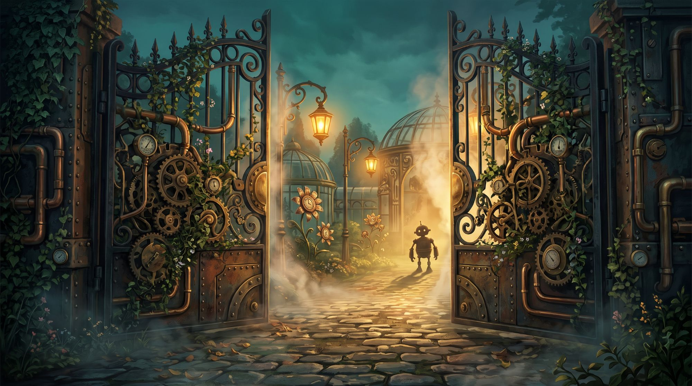

# Lesson 2: Night Two

Saturday 7 November 2026, 19:00 (`1794067200`).

## Before class

```
@Programming <t:1794067200:F> (<t:1794067200:R>)

:seedling: **The Teacher's Garden: Night Two** :seedling:

Last week, something woke up in the garden... :robot:

It has learned to listen. It has learned to speak. Now it wants **more**. :eyes:

What grows next? Even we don't know yet. **You decide what it becomes.** :herb:

:compass: **We return:** <t:1794067200:F> (<t:1794067200:R>)
:hourglass_flowing_sand: **Lasts:** about 2 hours

New faces welcome, the garden doesn't bite... much. :sunflower::bee:
```

## Class starts

The teacher swaps in the survey link before posting.

```
@Programming :seedling: **The garden is open!** :seedling:

The bot has been waiting all week... and it has been practising. :robot::eyes:

:loud_sound: **Join the voice channel**, we're starting now.
:ballot_box: **Keep this page open**, it's how you steer tonight: <survey link>

Let's see what grows. :herb:
```

Posted with this image, made with Gemini:



The prompt:

```
Create a wide 16:9 cinematic illustration of a grand steampunk garden gate at dusk. Two tall wrought-iron and brass doors are swinging open toward the viewer. The doors are covered in interlocking gears, copper pipes, pressure gauges and riveted panels, with ivy and small flowers growing through the metalwork. Warm golden light and drifting steam pour out through the opening, revealing a glimpse of a lush, glowing garden inside: brass lanterns, glass greenhouse domes, clockwork flowers slowly turning, and a small curious robot silhouette waiting on the path. A cobblestone path leads in, with fallen leaves and soft mist close to the ground. Warm amber and deep teal colours, volumetric light rays, rich painterly detail, an inviting and mysterious mood. Keep the image free of any text, letters, logos or watermarks, and leave out people.
```
